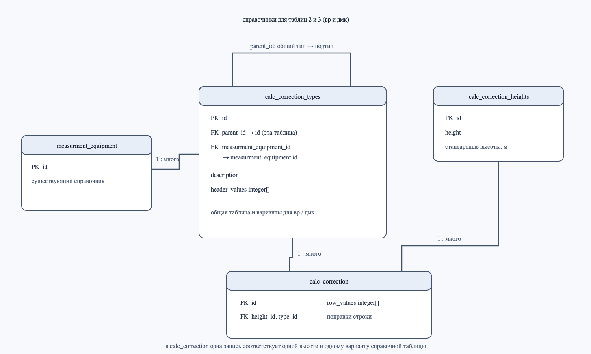

# справочники для расчета вр и дмк

для таблиц 2 и 3 используются три новые таблицы: `calc_correction_heights`, `calc_correction_types` и `calc_correction`. таблица оборудования `measurment_equipment` уже есть в базе, поэтому в этом скрипте она не создается.

## что хранится в таблицах

- `calc_correction_heights` — список стандартных высот в метрах. высота хранится один раз и получает свой код `id`.
- `calc_correction_types` — названия таблиц и их вариантов. в этой таблице можно описать общую таблицу 2, таблицу 3 для скорости и направления ветра, а также варианты для вр и дмк. поле `parent_id` связывает вариант с общей таблицей. поле `measurment_equipment_id` указывает оборудование для варианта. `header_values` хранит входные значения по столбцам: для таблицы 2 они задаются у общей записи, для таблицы 3 — у варианта оборудования.
- `calc_correction` — строки справочных значений. в `height_id` записан код высоты, в `type_id` — код варианта таблицы, а `row_values` хранит значения строки в том же порядке, что и `header_values`.

для таблицы 2 в `row_values` записываются температурные отклонения. положительные и отрицательные значения хранятся как разные варианты типа таблицы. для таблицы 3 значения скорости ветра и поправки направления хранятся отдельно для каждого оборудования.

## связи

- одна стандартная высота может использоваться во многих строках `calc_correction`;
- один тип таблицы может иметь строки для разных высот;
- один общий тип может иметь несколько вариантов таблицы через `parent_id`;
- один тип оборудования может быть указан у нескольких вариантов таблицы.

в `calc_correction` одна строка связывает высоту с вариантом таблицы. набор `row_values` соответствует столбцам `header_values` по порядку; длина массивов должна совпадать. отдельные значения массива не имеют собственных строк в таблицах, как и в скрипте миграции из репозитория.

## файлы

- структуру таблиц создает [`20261102_reference_data.sql`](../_Infra/scripts/20261102_reference_data.sql);
- связи показаны на картинке ниже.

