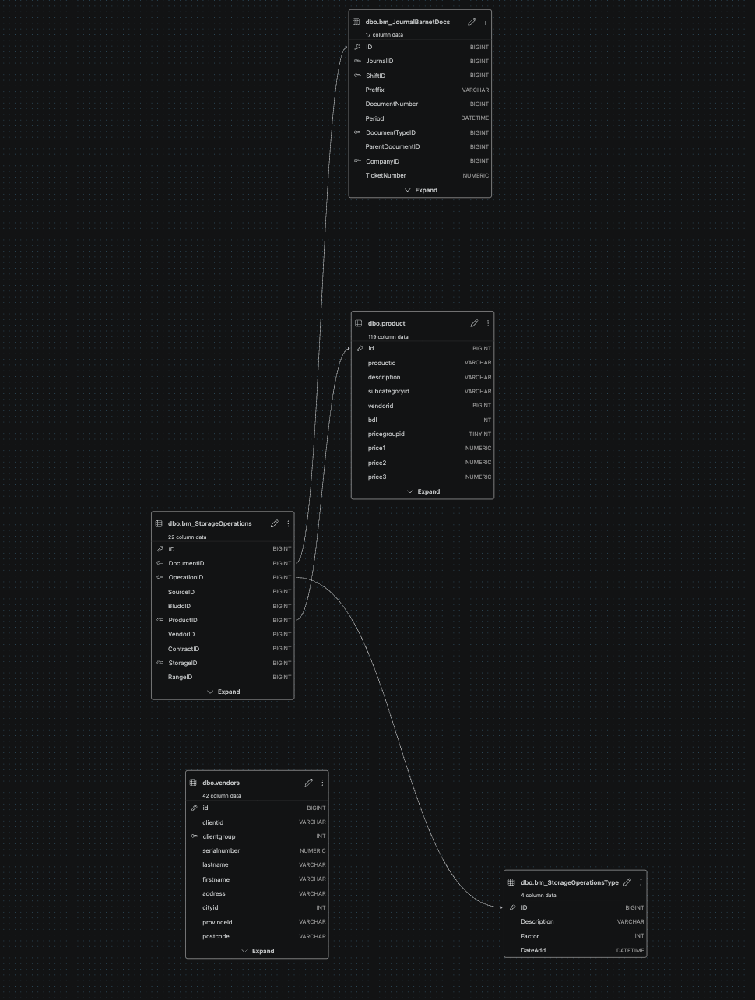
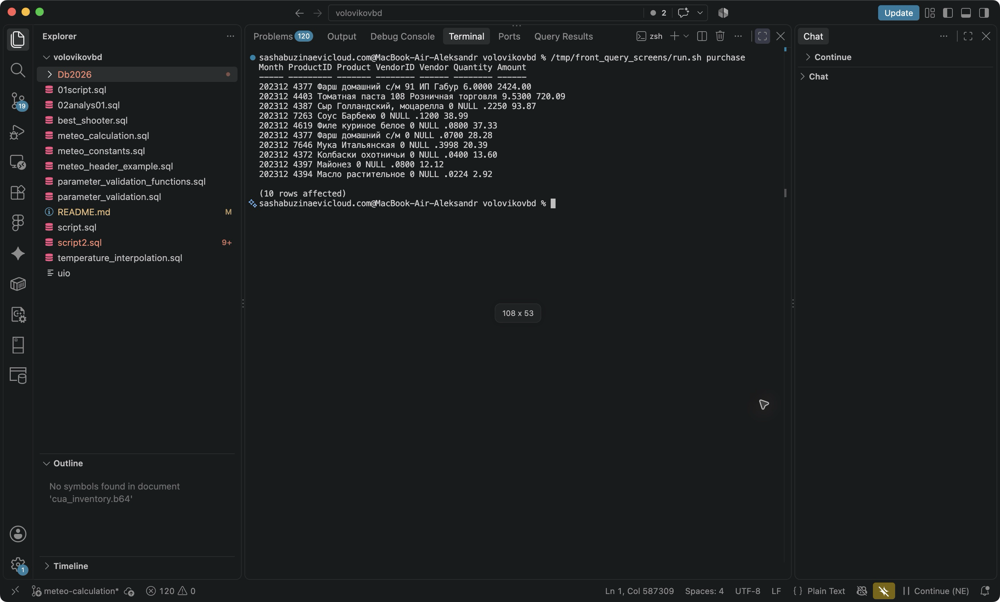
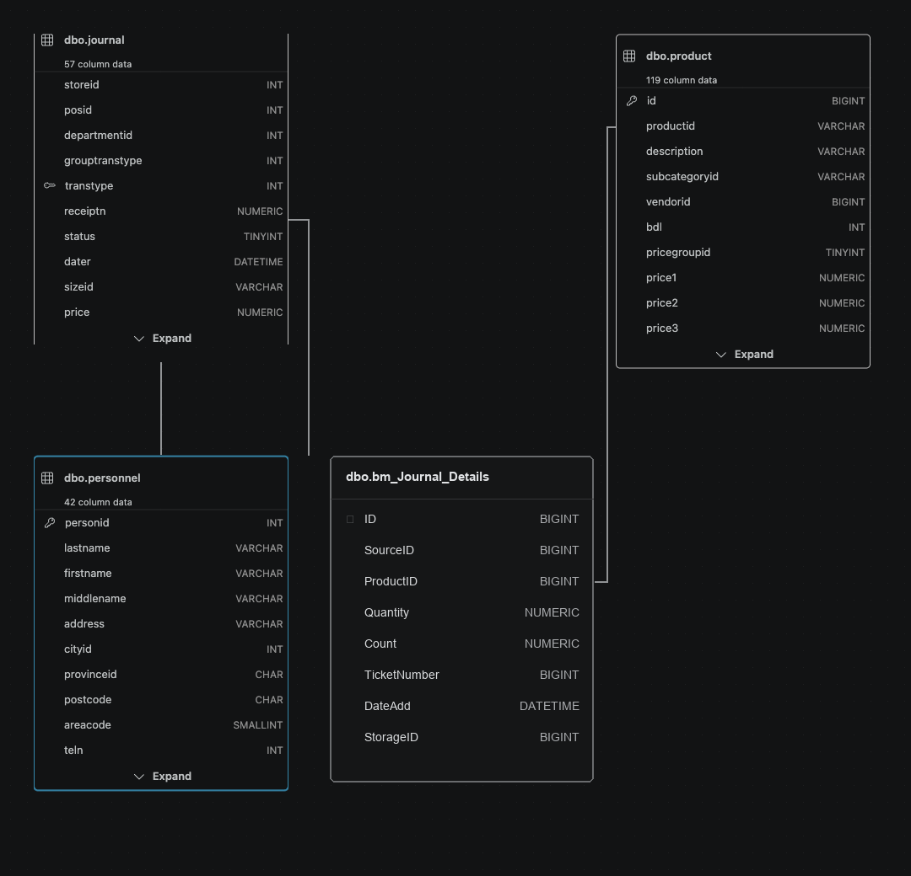
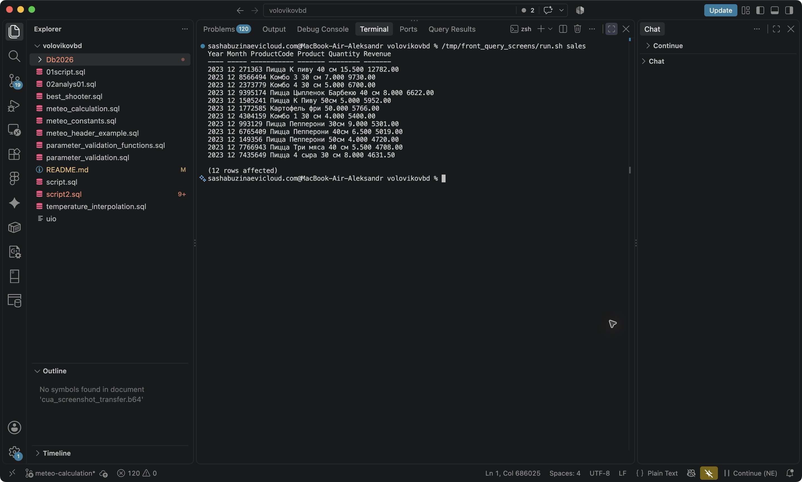
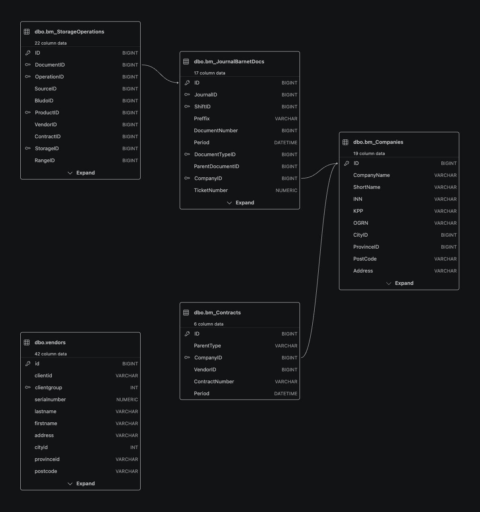
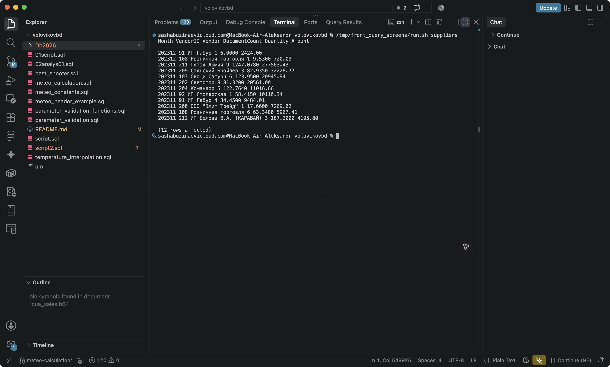
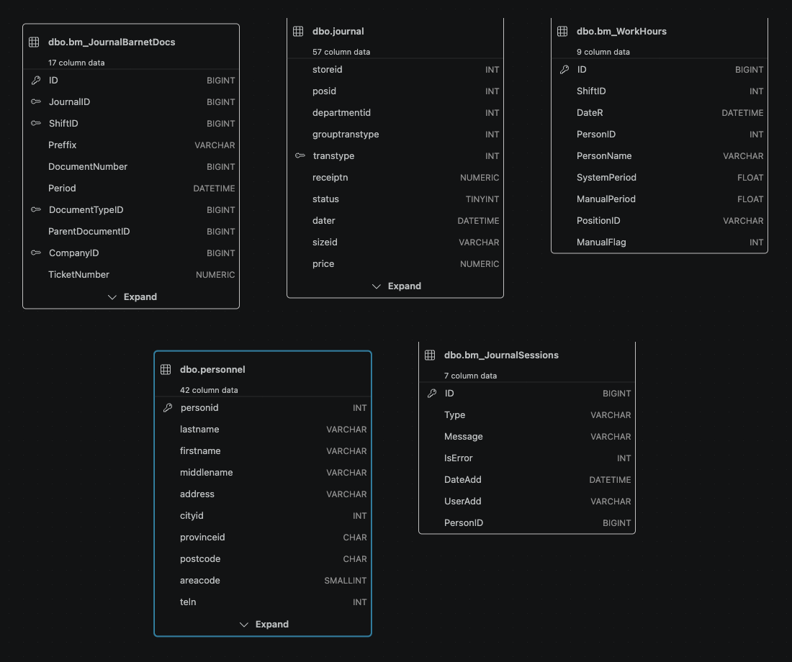
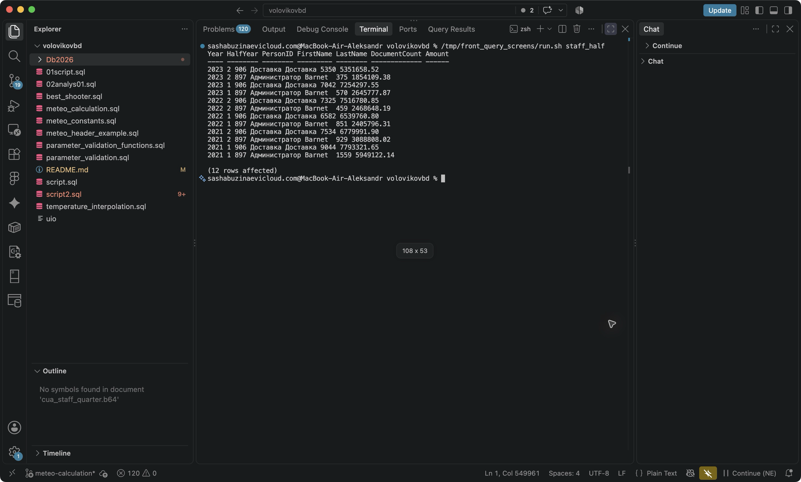
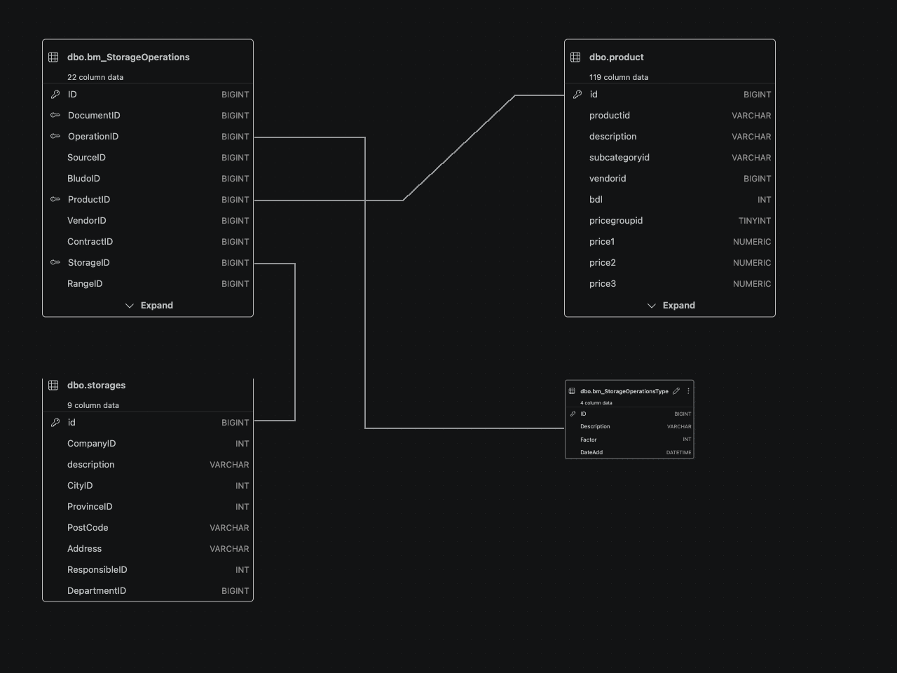
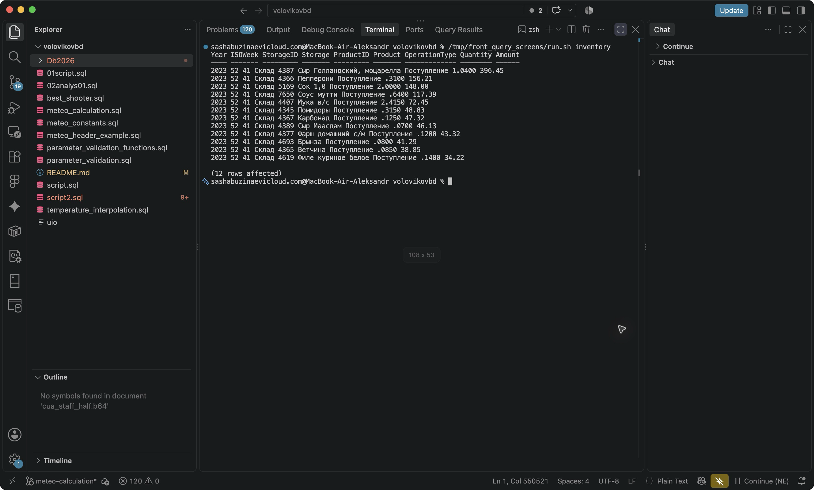

# Анализ базы Front

## 1. Закупка продукции

На схеме показаны складские операции, документы, товары и поставщики. Запрос выводит закупки по месяцам.

Результат запроса:

## 2. Продажа товара

На схеме показаны кассовый журнал, товары и связанные записи. Запрос показывает продажи товаров по месяцам.

Результат запроса:

## 3. Взаимоотношения с поставщиками

На схеме показана связь поставщиков с поступлениями и документами. По запросу можно сравнить поставщиков по месяцам.

Результат запроса:

## 4. Работа персонала

На схеме показаны сотрудники и связанные с ними документы. Запросы группируют документы по кварталам и полугодиям.

Результат за квартал:

Результат за полугодие:

## 5. Остатки

На схеме показаны товары, склады и движения запасов. Запрос выводит недельное движение товаров.

Результат запроса:

